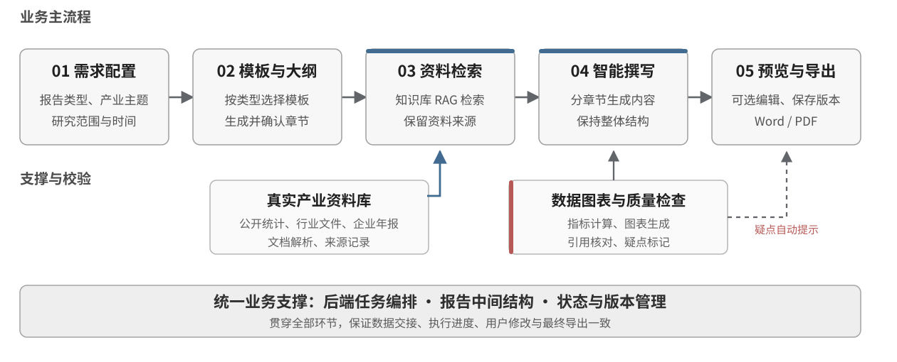

<!-- _class: cover -->
<!-- _paginate: false -->

## 产业智能报告自动生成系统
# 开题报告

**软工管 G05**

成员：王凯乐、潘永健、陈易、叶泽晨、廖晨皓、**常珂舒**

---

<!-- _class: source -->

# 01｜课题内容

### 具体定义

面向政府智库、产业规划、行业研究等真实场景，构建模板化、结构化、可溯源、可定制的产业大模型报告生成引擎，实现产业分析报告、景气报告、对标报告、招商报告、出海研判报告的智能自动化生成。

### 项目目标

解决传统产业研究文稿撰写效率低、结构不规范、数据联动弱的痛点，实现产业文稿智能化、标准化、体系化产出。

### 核心开发内容

1. 多类型产业研究报告模板体系设计与管理。
2. 大模型长文本结构化生成、章节逻辑自动组织、内容智能填充。
3. 数据自动嵌入、图表自动生成、观点溯源、幻觉抑制。
4. 公文风格润色、多格式文件导出、报告版本管理体系。

### 选题适配说明

适合擅长大模型工程、长文本生成、模板引擎、后端架构的团队，业务落地性极强。

<small>摘自课程文件《产业网链大模型十大软件工程创新实践课题》</small>

---

# 02｜课题需求提炼

**一　模板管理与报告定制**  

支持不同产业报告类型，能够确定章节结构、研究范围和文档格式。

**二　结构化的智能内容生成**  

根据报告主题规划大纲；调用大模型逐章撰写，并保持章节之间的逻辑一致性。

**三　真实数据、图表与观点溯源**  

从公开产业资料中获取依据，整理数据和可视化图表；重要数据与观点能够追溯来源，并对存疑内容进行提示。

**四　报告编辑、润色与输出**  

支持正式文风调整、可选的人工编辑与局部修改，以及 Word/PDF 导出和报告版本管理。

**五　软件工程交付要求**  

形成能够运行、测试、部署和演示的完整系统，而不是静态页面或单次模型生成结果。

**我们组的目标：** 优先实现产业分析报告、企业对标报告两类模板，完成“配置需求—知识库检索—自动生成与质量检查—导出”的完整闭环。

---

<!-- _class: workflow -->

# 03｜整体实现路径：从用户需求到正式报告

**总体思路概括：** 

以模板管理报告结构，以真实产业资料支撑智能生成，以程序计算和来源核验提高可信度，最后统一编辑排版导出。

<small>图中蓝色用于标记知识库 RAG 与智能生成环节，红色用于标记质量检查及风险提示；其余为业务与基础支撑模块。</small>

---

<!-- _class: impl -->

# 04｜实现过程：产业资料与知识库

### 资料准备：让报告具有真实依据

- 事先收集公开、可核实的产业数据和文件，例如行业统计、政策文件、研究资料、企业年报，并整理到知识库中。
- 支持用户上传资料；对文件内容进行解析、整理、分类和去重。
- 保存文档名称、发布时间、页码或网址等信息，为后续引用提供依据。

### 检索增强：先找资料，再生成观点

- 在**已建设的产业知识库**内，按章节主题、时间和行业等条件寻找相关片段；本阶段不依赖实时互联网搜索。
- 通过 **RAG（检索增强生成）** 将相关证据提供给大模型，而不是单纯依赖模型已有知识。
- 遇到资料不足或不同来源口径不一致的情况，保留提示或请求补充资料。

> **预期结果：** 
生成报告时，系统能够说明“使用了哪些资料、某个数据来自哪里”，为章节撰写、图表和质量检查提供共同的数据基础。

---

<!-- _class: impl -->

# 05｜实现过程：模板、大纲与智能撰写

### 1. 先定义报告结构

不同类型的报告使用不同的章节模板。例如：

- **产业分析报告：** 行业概况、市场规模、产业链结构、政策环境、发展趋势。
- **企业对标报告：** 企业概况、经营指标、核心技术、竞争优势、对比结论。

### 2. 让大模型规划与生成内容

- 用户选择模板并填写研究主题、地区、时间等需求。
- 大模型根据模板提出具体大纲；用户可以确认或调整。
- 每个章节分别检索对应资料，再分章节生成内容与必要的说明文字。

### 3. 保证全文可以被后续处理

- 各章节使用统一的数据结构交接，包含标题、正文和引用关联。
- 全文共享研究范围、核心数据及重要术语，减少重复、遗漏和前后矛盾。
- 后续支持只重新生成某一章节，而不必覆盖整份报告。

> **预期结果：** 从一个报告主题生成结构完整、内容可修改、能继续插入数据与图表的报告初稿。

---

<!-- _class: quality impl -->

# 06｜实现过程：数据图表、溯源与质量控制

### 数据与图表：计算交给程序，解释交给大模型

对检索到的统计指标进行必要的数据整理与计算，再生成表格、折线图、柱状图等；大模型负责结合数据撰写分析，不直接承担关键数值计算。

### 观点溯源：正文与原始资料建立关联

将重要数字、结论与资料片段、文件位置或来源链接关联。用户查看报告时可以定位引用，导出时也保留对应的参考信息。

### 质量检查：优先解决明确可验证的问题

重点检查单位、年份、统计范围、关键数值及引用是否匹配；对缺少证据、来源冲突或生成异常的内容给出提示。

> **质量边界：** 引用存在不等于观点必然正确。系统自动检查并标注缺少依据或存疑的内容，不设置强制人工审核环节。

> **预期结果：** 报告需要具有可查看的数据图表与可追踪的论述依据。

---

<!-- _class: impl delivery -->

# 07｜实现过程：用户编辑与正式报告交付

### 在线预览与局部修改

系统自动生成报告后，用户**可选择**查看提纲、章节、图表和引用，也可对某一章进行编辑、重新生成或润色；这些操作不是导出的必要条件。

### 报告版本与生成状态

系统记录生成进度、完成情况和历史报告；编辑或重新生成后保留必要版本，避免用户修改的内容被直接覆盖。

### 统一模板与文件导出

由统一的报告结构生成正式文件，包括封面、标题层级、章节正文、图表和参考来源；支持 Word/PDF 下载，尽量保持网页内容与导出内容一致。

### 需要考虑的异常情况

资料不足、单章生成失败、模型超时、引用检查存疑、导出失败等情况，应能给出明确提示，并允许重试或补充资料。

> **最终演示效果：** 
用户创建报告任务后，系统可基于知识库自动完成生成、基础质量检查和 Word/PDF 导出；在线查看与修改由用户自主选择。

---

<!-- _class: compact -->

# 08｜技术栈与开发方式

| 技术方向 | 课程推荐技术与拟采用路线 | 在系统中的作用 |
|---|---|---|
| **前端** | Vue | 配置报告、预览编辑、任务进度、下载 |
| **后端** | Python | 业务接口、任务协调、状态与版本管理 |
| **大模型能力** | 大模型 API、提示词工程、基于知识库的 RAG | 大纲规划、资料增强、章节生成、润色 |
| **数据底座** | MySQL；按实际需求评估 Neo4j | 管理业务数据、报告记录、产业资料 |
| **辅助工具** | 文档解析、统计计算、图表与文件生成组件 | 数据处理、可视化与 Word/PDF 输出 |
| **团队协作** | Git、分支开发、代码审查、迭代测试 | 并行开发、集成与质量控制 |

**开发方式：** 
先确定统一的报告内容结构及模块接口，再分工并行开发；采用“最小链路验证 → 完整功能集成 → 测试部署交付”的迭代方式。

---

<!-- _class: compact -->

# 09｜团队分工

| 成员 | 开发模块 | 主要职责 |
|---|---|---|
| **常珂舒** | **模板与文档导出** | 报告模板、排版与 Word/PDF 导出；兼顾进度协调、接口审查和最终集成 |
| **王凯乐** | **产业资料与知识库** | 资料收集、文档解析、知识库检索及来源维护 |
| **潘永健** | **智能报告生成** | 章节规划、提示词设计、逐章生成与局部重写 |
| **陈易** | **数据与质量控制** | 统计指标、图表制作、引用关联与数值检查 |
| **叶泽晨** | **后端与系统服务** | 数据库、接口、任务调度、状态及版本记录 |
| **廖晨皓** | **前端交互界面** | 报告配置、预览编辑、进度反馈与下载操作 |

**共同协作要求：** 
各模块独立开发、测试并提交代码，统一输入输出和报告中间结构；组长解决跨模块接口问题，组织代码审查与端到端联调。

---

<!-- _class: compact -->

# 10｜项目成本分析：运行开支

**主要付费来源：大模型 API。** 报告生成涉及大纲规划、按章检索后的多次生成、润色与必要重试；应按**一份完整报告的累计 token 用量**计费，而非单次请求。

| 测算项目 | 估算口径（示例，非实测） | 说明 |
|---|---|---|
| 单份报告调用量 | 输入 10 万 tokens；输出 2 万 tokens | 包含多章生成与必要的重复上下文 |
| 经济型 API | DeepSeek Flash 离峰：约 **$0.027/份** | 按未命中缓存计算；高峰约 $0.054/份 |
| 较强模型方案 | DeepSeek Pro 离峰：约 **$0.106/份** | 同一用量，高峰约 $0.211/份 |
| 100 份报告 | 约 **$2.7–$21.1** | 仅模型文本调用，实际费用按用量和模型确定 |

其他成本：资料解析/向量化可能产生 Embedding API 费用；部署、数据库与文件存储可优先使用成员现有设备或免费资源，若租用云服务则另计。模型重试、长上下文和并发请求会提高实际消耗。

<small>价格依据：DeepSeek 官方 API 定价（2026-10-26 查询），单位美元；示例未计缓存折扣、税费及其他服务。https://api-docs.deepseek.com/quick_start/pricing/</small>

---

<!-- _class: compact -->

# 11｜项目成本分析：开发工具与控制策略

**需要区分“系统运行成本”和“成员开发成本”。**

| 类别 | 可能的消耗 | 成本处理 |
|---|---|---|
| **系统 API 账户** | 正式报告生成与集成测试的输入/输出 tokens | 项目统一记录调用量和实际费用 |
| **个人 AI Agent** | 成员使用 Codex 等工具辅助写代码、测试、审查时消耗订阅额度或配额 | 不等同于系统 API 调用费；个人实际额度与额外付费尚未统计 |
| **开发与部署** | 本地算力、知识库索引、存储、可能的云服务 | 优先复用现有资源；新增付费项目先确认 |

**拟采用的成本控制方式**

1. 开发阶段使用少量固定资料与短报告调试，避免每次修改都生成完整报告。
2. 记录每次任务的模型、输入/输出 tokens、失败重试次数和累计费用；设置预算提醒或额度上限。
3. 对章节生成、质量检查采用按需调用策略，避免将可程序化完成的计算交给高价大模型。

结论：系统 API 消耗可通过调用日志量化；AI Agent 的个人配额属于开发资源，**不能在没有成员实际记录的情况下推算团队总费用**。

---

<!-- _class: compact -->

# 12｜相关项目调研：可借鉴的成熟方案

| 项目与定位 | 已具备的相关能力 | 我们主要借鉴什么 |
|---|---|---|
| **Dify**：开源大模型应用平台 | 工作流编排、模型接入、RAG 管道、调用日志 | **任务分阶段编排、模型调用管理与可观察性** |
| **RAGFlow**：开源 RAG 引擎 | 复杂文档解析、文本切片、多路检索、可追溯引用 | **资料入库、证据标识、引用定位与检索质量** |
| **Microsoft GraphRAG**：图结构检索方法 | 从文本提取实体关系、构建分层摘要与图检索 | **复杂产业关系分析的可选参考**，非首版依赖 |

**调研结论：**现有项目分别覆盖工作流、知识库检索与图结构增强，但并不直接等同于本课题的完整产业报告生成系统。我们计划结合其设计思路，自行实现**报告模板、章节生成、数据图表、质量提示、版本与 Word/PDF 导出**的业务闭环。

选型边界：借鉴架构与接口思路，不代表必须整体部署或复制上述系统；尤其 GraphRAG 索引涉及额外计算和费用，不纳入目前已确定的知识库检索方案。

<small>来源：github.com/langgenius/dify ｜ github.com/infiniflow/ragflow ｜ github.com/microsoft/graphrag（项目官方仓库，2026-10-26 查询）。</small>

---

<!-- _class: next -->

# 13｜未来规划

1. **统一项目范围与演示目标**  
   确定首个产业主题、两类报告的核心结构和首版 MVP 必须完成的功能。

2. **确定模块接口与共同数据结构**  
   先约定章节内容、资料出处、图表、任务状态与报告版本如何在各模块间交接。

3. **建立仓库与协作规范**  
   创建 Git 仓库，确定目录、分支和代码审查规则，明确每人的阶段交付及测试责任。

4. **准备真实数据并验证最小链路**  
   收集第一批产业资料，初步实现“检索真实证据 → 生成一章 → 导出 Word”。

5. **安排后续里程碑与集成测试**  
   依次完成六模块开发、端到端联调、异常处理、部署和最终演示。

---

<!-- _class: end -->
<!-- _paginate: false -->

# 感谢倾听

**产业智能报告自动生成系统｜开题报告**

**软工管 G05**

组员：王凯乐、潘永健、陈易、叶泽晨、廖晨皓、**常珂舒**