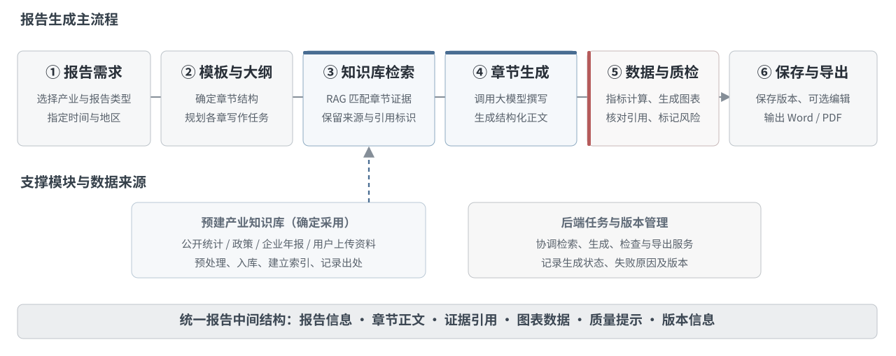

# 产业智能报告自动生成系统——项目计划书

**小组：** 软工管 G05  
**成员：** 常珂舒、王凯乐、潘永健、陈易、叶泽晨、廖晨皓  
**当前阶段：** 进行需求确认与技术验证

本文依据课程《产业网链大模型十大软件工程创新实践课题》中的课题 2、现有《软工管方案书》及《开题报告》编制，用于明确项目范围、成员职责、开发顺序与验收要求。尚未确定的技术细节和时间节点，将在项目启动阶段进一步确认。

## 一、项目目标与范围

### 1. 项目目标

开发面向产业研究场景的**智能报告自动生成系统**。用户输入产业主题、报告类型、研究地区及时间范围后，系统通过预建产业知识库检索资料，结合大模型完成大纲组织、分章节写作、数据与图表处理、引用溯源及基础质量检查，并输出 Word/PDF 报告。

项目重点是构建**模板化、结构化、可溯源、可定制**的软件系统，而非单次文本生成。按照课程要求，成果须使用真实产业数据，具备实际智能能力，并完成需求、设计、开发、测试、部署与文档交付；不涉及底层大模型预训练。

### 2. 功能范围

| 类别 | 计划内容 |
|---|---|
| **首版核心功能** | 产业分析、企业对标两类报告模板；产业资料导入及知识库检索；大纲与逐章生成；基础统计图表；引用溯源；自动质量检查；网页操作；Word/PDF 导出 |
| **迭代完善功能** | 章节级重新生成、可选人工编辑、公文风格润色、报告版本管理、任务进度及异常重试 |

**采用预建知识库与 RAG 检索。** 实时在线检索仅作为未来可能评估的扩展方向。系统不设置强制人工审核步骤；用户可以直接获取生成结果，并自主选择编辑或重新生成。

## 二、整体实现路线

系统以用户填写的报告需求为起点，以**已建设的产业知识库**作为事实依据，由后端协调模板、大模型、数据处理和文档导出模块，形成可追溯的报告成果。核心流程为：

**需求配置 → 模板与大纲 → 知识库检索 → 分章节生成 → 数据图表及自动检查 → 保存报告 → Word/PDF 导出**

*图示说明：上方为主要业务流程；下方为知识库、后端服务与统一报告数据结构。网页预览、人工编辑和局部重写属于可选操作，不影响系统自动生成与导出。*

### 1. 资料准备与知识库建设

项目开始时，由资料模块收集公开产业统计、政策文件、行业报告及企业年报，并支持用户补充上传资料。系统对文档进行解析、分类和必要的数据清洗，将可检索内容与原始资料建立关联。

除文本外，还应尽量保留表格中的**指标名称、数值、单位、年份、地区和统计口径**，并记录文件名称、发布日期、页码或来源链接，供后续制图和引用核查使用。知识库只负责提供资料和证据，不直接生成报告结论。

本阶段的检索范围限定于**已导入的知识库**。检索请求可以根据产业主题、章节内容及时间范围筛选资料；若缺少相应证据，则向后续模块返回“资料不足”等明确结果，不以模型编造内容替代。

### 2. 用户需求、模板与大纲规划

用户通过前端选择报告类型、产业主题、研究地区和时间范围等条件。系统根据报告类型读取预设的章节模板：产业分析报告侧重行业概况、市场规模、产业链及发展趋势；企业对标报告侧重企业情况、经营指标及竞争比较。

模板提供基本章节规则和文档格式约束，大模型在此基础上组织具体大纲。大纲以可识别、可排序的章节数据保存，以便按章生成、调整顺序和独立修改。**章节内容结构与 Word/PDF 排版模板需要相互对应，但不应直接将整份报告保存为不可拆分的文本。**

### 3. RAG 检索与分章节智能生成

每个章节生成前，系统按照该章的研究任务向知识库发起检索，并把找到的证据、来源标识和写作要求提供给大模型 API。大模型负责将证据组织为分析文字，而不是自行虚构统计数据和引用来源。

生成模块按统一格式输出章节标题、正文及引用关联，并共享报告的研究范围、核心指标和术语信息，尽量减少章节间重复或矛盾。对格式不合法的模型结果进行校验与处理；对证据不足的部分保留提示，避免直接表述为已确认事实。

该模块同时预留**章节级重新生成**能力：后续用户只修改某一章时，不需要重写整个报告，也不应直接覆盖其他章节的现有内容。

### 4. 数据分析、图表生成与质量检查

数据模块从检索结果中整理相关统计指标，使用程序完成数值计算、单位换算及图表生成。报告正文和图表应引用同一组指标及原始来源，确保数值、年份、单位和地区等条件一致。大模型可以解释计算结果，但关键计算不由其自由生成。

质量检查优先覆盖能够明确验证的内容，包括引用是否存在、关键数字是否与证据一致、统计口径是否冲突、图表与正文是否对应，以及章节结构是否完整。发现问题后，系统记录具体位置和风险说明，必要时提示补充资料或重新生成。

**检查由系统自动执行，不设置强制人工审核。** 无法仅凭现有资料证实的产业判断需要标记存疑；自动检查旨在降低错误风险，而非保证所有生成观点绝对正确。

### 5. 报告整合、版本管理与文件导出

生成的章节、数据图表、引用和质量提示统一汇总到**报告中间结构**。后端保存报告及其版本，前端使用该结构展示内容；用户可以选择查看、编辑、润色或局部重新生成，也可以不经过人工修改直接导出。

文档模块根据报告类型选择相应排版模板，将封面、目录、章节、表格、图表与参考来源组合为 Word/PDF。导出时必须指定报告版本，避免“网页显示一份、下载得到另一份”的问题。即使文件导出失败，也应保留已完成的报告内容，提供错误提示和重试途径。

### 6. 后端协同与模块交接

后端负责从任务创建到结果保存的整体协调，包括调用顺序、生成进度、失败状态和版本记录；知识库、智能生成、质量检查及导出模块分别提供独立能力。各模块通过统一的报告结构、证据标识和任务状态交换结果，减少重复实现和集成冲突。

其中，**知识库输出证据，生成模块输出章节，质量模块输出图表与检查结果，导出模块输出正式文件**。这些责任边界需要在开发前落实为接口约定，具体字段和框架在设计阶段确定。

### 7. 技术方向

| 技术层次 | 当前方案 |
|---|---|
| 前端 | Vue |
| 后端 | Python |
| 大模型 | 大模型 API、提示词工程 |
| 检索增强 | 基于已导入产业资料的 RAG |
| 数据存储 | MySQL；仅在确有图关系需求时评估 Neo4j |
| 辅助工具 | 文档解析、统计计算、图表绘制及 Word/PDF 生成组件 |
| 工程管理 | Git、分支开发、代码审查、迭代测试 |

模型服务、检索组件、文件导出工具及部署环境尚需验证后确定，避免提前引入不必要的技术复杂度。

## 三、人员分工与交付内容

| 成员 | 负责模块 | 主要任务及交付 |
|---|---|---|
| **常珂舒（组长）** | 模板与文档导出 | 负责两类报告的模板、排版与 Word/PDF 导出；交付导出模块及样例。另负责进度统筹、接口审查和最终集成 |
| **王凯乐** | 产业资料与知识库 | 负责真实资料收集、导入解析、检索和来源维护；交付可查询的知识库及证据结果 |
| **潘永健** | 智能报告生成 | 负责大纲规划、提示词、逐章生成与局部重写；交付结构化的报告生成模块 |
| **陈易** | 数据与质量控制 | 负责指标计算、图表生成、引用与数值检查；交付图表结果、检查记录和风险提示 |
| **叶泽晨** | 后端与系统服务 | 负责业务接口、数据库、任务调度、状态与报告版本管理；交付后端服务及接口说明 |
| **廖晨皓** | 前端交互界面 | 负责报告配置、生成进度、内容预览编辑、引用展示和下载交互；交付可操作的 Web 页面 |

每名成员均负责所承担模块的开发、基本测试和必要文档。组长除独立开发任务外，组织跨模块评审、联调和验收；公共汇报材料由全组协作完成。

## 四、需要优先统一的接口

为了保证六个模块能够集成，应在并行开发前约定**统一的报告中间结构**，至少包含：报告类型及主题、章节身份与顺序、正文、证据与引用、统计数据与图表、质量检查结果、任务状态及版本信息。先形成一份可供各模块测试的样例，再确定具体字段。

| 交接关系 | 需要明确的边界 |
|---|---|
| 模板 ↔ 智能生成 | 模板规定的章节约束；生成结果怎样填入模板；章节调整如何同步 |
| 知识库 ↔ 智能生成 | 检索条件、证据内容、来源定位及无结果时的返回方式 |
| 知识库 ↔ 质量控制 | 统计指标、单位、年份、地区、统计口径与原始来源的表达方式 |
| 智能生成 ↔ 质量控制 | 数值核验、图表位置、引用标识及疑点反馈的交接方式 |
| 智能生成 ↔ 后端 | 章节生成逻辑与系统任务调度、失败重试的职责划分 |
| 前端 ↔ 后端 ↔ 导出 | 任务创建与进度、报告编辑、当前版本、文件下载及失败提示 |

**主要责任边界：** 后端负责整体任务编排，生成模块负责具体章节内容；知识库负责提供证据，质量模块负责计算与检查；文档导出模块与前端使用一致的报告内容和版本。共享接口发生变更时，须通知相关负责人并更新约定。

## 五、实施阶段与里程碑

项目计划周期为**10 周**，从本阶段起按每周 5 个工作日、每人每天平均投入 1 小时安排。各模块依据已确认的接口并行开发，并在开发过程中开展必要的技术测试；具体会议日期及任务节点由小组确认。

| 阶段 | 主要工作 | 阶段完成标准 |
|---|---|---|
| **阶段 0：启动与设计（第 1–2 周）** | 确定演示产业、首版范围和技术方案；建立 Git 仓库；明确统一报告结构、接口与测试数据 | 完成分工、总体设计、接口约定及协作规范 |
| **阶段 1：模块并行开发（第 3–7 周）** | 分别实现知识库、智能生成、数据质检、模板导出、后端服务与前端页面；同步开展模块测试 | 六个模块具备约定功能，并提供可供集成的接口和测试结果 |
| **阶段 2：系统集成与测试（第 8–9 周）** | 统一联调需求配置、资料检索、章节生成、质量检查、版本保存及 Word/PDF 导出 | 完整生成流程可由网页操作，主要数据与引用能够正确交接 |
| **阶段 3：完善与交付（第 10 周）** | 完善关键异常处理、报告版本和排版；执行验收测试、部署系统并提交课程文档 | 两类报告均可生成，系统可部署、可运行、可演示 |

**阶段管理要求：** 每一阶段以实际功能、测试记录和接口符合性作为验收依据；若并行开发中出现共享结构变更，由相关成员及时协调并同步修改。

## 六、成本与资源安排

### 1. 经费预算

本项目计划以现有计算机和开发资源为基础，采用外部大模型 API，避免自行部署或训练大型模型。现阶段设定以下**规划预算**，并非实际支出或已确认的成员订阅费用。

| 预算项目 | 预算金额 | 使用范围 |
|---|---:|---|
| 大模型 API | **100 元** | 报告生成、提示词调试、联调及测试期间的模型调用 |
| 成员 AI 开发工具 | **100 元/人 × 6 人 = 600 元** | Codex 等 AI Agent 辅助编码、审查、测试的个人工具预算 |
| **合计** | **700 元** | 项目暂定经费上限，不含新增付费云资源 |

### 2. 时间与人力成本

按**10 周 × 每周 5 天 × 每天每人 1 小时 × 6 人**进行安排：

| 统计口径 | 计划投入 |
|---|---:|
| 单人每周 | 5 小时 |
| 单人全周期 | 50 小时 |
| 全组每周 | 30 人时 |
| **全组 10 周合计** | **300 人时** |

## 七、相关项目调研与借鉴

考虑到本项目同时涉及大模型工作流、文档检索和报告生成，计划参考以下公开项目的设计与实现经验，而非整体复制现有平台。

| 参考项目 | 主要相关能力 | 计划借鉴的内容 |
|---|---|---|
| **Dify** | 工作流编排、模型接入、知识库与调用日志 | 将大纲、检索、生成、检查、导出组织成可观察的阶段流程；记录调用和失败状态 |
| **RAGFlow** | 文档解析、知识检索、证据引用 | 参考资料分段、元数据保存、检索结果关联来源以及引用定位的实现思路 |
| **Microsoft GraphRAG** | 实体关系组织、图结构检索与分层摘要 | 作为复杂产业关系分析的技术参考；**不列入首版实现范围** |

上述项目的官方仓库分别为 [Dify](https://github.com/langgenius/dify)、[RAGFlow](https://github.com/infiniflow/ragflow) 和 [Microsoft GraphRAG](https://github.com/microsoft/graphrag)。具体是否采用其开源组件，将结合团队技术能力、部署条件和许可要求决定。

自主建设重点仍为两类产业报告模板、基于预建知识库的 RAG 生成、数据图表与质量检查、报告版本管理及 Word/PDF 导出的业务整合。GraphRAG 和实时在线检索仅作为未来可能的扩展方向，不构成当前开发承诺。

## 八、测试、验收与风险控制

### 1. 验收重点

- **资料可信：** 知识库能够检索真实资料，并定位原始来源；检索不到时有明确反馈。
- **生成完整：** 两类模板的章节结构正确，模型输出能够被后续模块可靠处理。
- **数据一致：** 关键数值、单位、图表与引用来源相符；存疑内容得到提示。
- **流程稳定：** 生成进度真实可见，超时、失败及导出异常可识别并按设计处理。
- **版本一致：** 局部修改不误覆盖其他章节，网页显示与指定版本导出文件一致。
- **工程交付：** 能够部署并演示完整流程，提交源代码、设计资料、测试记录、部署与使用说明等课程要求成果。

### 2. 主要风险及处理

| 风险 | 应对方式 |
|---|---|
| 知识库覆盖不足 | 优先准备资料充分的演示产业；不足时提示，不虚构数据 |
| 模块接口不兼容 | 先确定报告中间结构和测试样例，尽早联调 |
| 模型输出不稳定 | 结构化校验、逐章生成、失败重试与共享核心事实 |
| 数值或引用错误 | 程序化计算、来源关联及基础自动检查 |
| 开发范围扩大 | 优先保证知识库到报告导出的闭环，扩展能力另行评估 |

执行重点是：**先统一需求与接口，再开展模块开发，随后进行系统集成、测试和交付。** 
